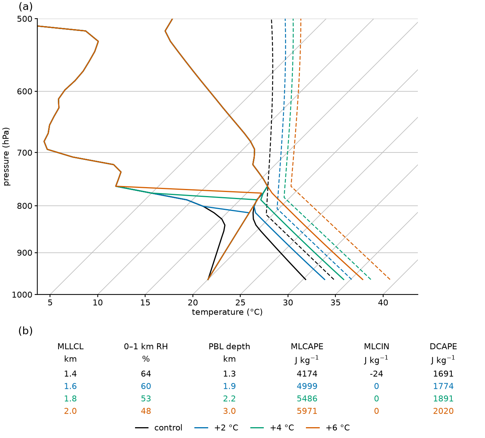
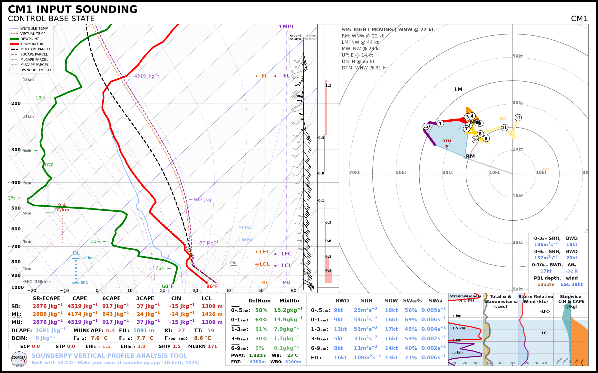

.. _case-study-cm1-surface-heating:

=========================================================
🔬 Case Study: CM1 Surface Heating
=========================================================

   *A CM1 base state (control) and the same sounding with its surface 2, 4, and 6 °C warmer.*

********************************************************

Study Goals
===========

**How much does a warmer surface raise the LCL and dry the sub-cloud layer?**

Starting from one CM1 base state, we heat the surface by 2, 4, and 6 °C, compare the runs on one figure, and write
each one out as a new ``input_sounding``. Surface moisture and winds are the same in every run.

***************************************************************

1. Open the CM1 Sounding
========================

This study uses SounderPy's test sounding
(`test_data/input_sounding <https://raw.githubusercontent.com/kylejgillett/sounderpy/main/test_data/input_sounding>`_);
any ``input_sounding`` works. ``spy.from_cm1()`` takes the location and elevation the file doesn't hold (see
:doc:`/reference/customdatasources`):

.. code-block:: python

   import sounderpy as spy

   metadata = {'latlon': [35.2, -97.4], 'elev': 380, 'top_title': 'CM1 INPUT SOUNDING',
               'left_title': 'CONTROL BASE STATE', 'right_title': 'CM1'}

   control = spy.from_cm1('input_sounding', metadata)
   spy.build_sounding(control, map_zoom=0)    # no map for an idealized profile

***************************************************************

2. Heat the Surface
===================

``spy.modify_surface()`` returns a modified copy of a profile (see :ref:`modify_surface`). With
``'method': 'mix'``, the warmer surface is mixed up its dry adiabat, and passing the surface dewpoint holds its
mixing ratio constant through the new mixed layer (see :ref:`modify_sfc`).

.. code-block:: python

   T_sfc = control['T'][0].to('degC').m
   Td_sfc = control['Td'][0].to('degC').m

   runs = {'control': control}
   for warming in (2, 4, 6):
       runs[f'+{warming} °C'] = spy.modify_surface(control, {'T': T_sfc + warming, 'Td': Td_sfc, 'method': 'mix'})

***************************************************************

3. Compare the Parameters
=========================

.. code-block:: python

   for name, profile in runs.items():
       params = spy.sounding_params(profile).calc()
       thermo, general = params['thermo'], params['general']
       print(f"{name:8s}  MLLCL {thermo['ml_lcl_z']:5.0f} m   0-1 km RH {general['rh_0_1000']:3.0f} %   "
             f"PBL depth {thermo['pbl_depth']:5.0f} m   MLCAPE {thermo['mlcape']:5.0f}   MLCIN {thermo['mlcin']:4.0f}")

.. code-block:: text

   control   MLLCL  1426 m   0-1 km RH  64 %   PBL depth  1333 m   MLCAPE  4174   MLCIN  -24
   +2 °C     MLLCL  1556 m   0-1 km RH  60 %   PBL depth  1891 m   MLCAPE  4999   MLCIN    0
   +4 °C     MLLCL  1797 m   0-1 km RH  53 %   PBL depth  2188 m   MLCAPE  5486   MLCIN    0
   +6 °C     MLLCL  2035 m   0-1 km RH  48 %   PBL depth  2983 m   MLCAPE  5971   MLCIN    0

Each 2 °C of heating raises the LCL by 130–240 m and dries the lowest kilometer by 4–7% RH, while adding CAPE and
removing the CIN. Every parameter's group and key is on :doc:`Parameters & References </reference/references>`.

***************************************************************

4. Plot the Runs Together
=========================

.. code-block:: python

   fig, axes = spy.build_publication_sounding(
       list(runs.values()), labels=list(runs), panels=('skewt', 'parameters'),
       colors=['black', '#0072B2', '#009E73', '#D55E00'], ylim=(1000, 500), show_barbs=False,
       parameters=('mllcl', ('0–1 km RH', 'general', 'rh_0_1000', 1, '%', 0),
                   ('PBL depth', 'thermo', 'pbl_depth', 0.001, 'km', 1), 'mlcape', 'mlcin',
                   ('DCAPE', 'thermo', 'dcape', 1, r'J kg$^{-1}$', 0)))

   fig.savefig('cm1_surface_heating.pdf')

The winds are the same in every run, so the figure leaves out the hodograph and barbs and zooms in on the lowest
levels. The colors are colorblind-safe (Okabe & Ito), and the tuples in ``parameters`` add values that aren't
built in (see :ref:`publication_parameters` and :doc:`/tutorials/custom_figures`).

***************************************************************

5. Save the Runs for CM1
========================

.. code-block:: python

   for warming in (2, 4, 6):
       spy.to_file('cm1', runs[f'+{warming} °C'], filename=f'input_sounding_plus{warming}C')

Read back with ``spy.from_cm1()``, values may differ from the table by a few tens of meters, since the file stores
θ and q\ :sub:`v` on height levels (see :ref:`tutorial-exporting-data`).

***************************************************************

Going Further
=============

* **Moisture**: change ``'Td'`` along with ``'T'``.
* **A shallow surface layer**: ``'method': 'blend'`` with a ``'depth'``, or ``'method': 'replace'`` for the lowest
  level only (see :ref:`modify_sfc`).
* **Surface wind**: ``'ws'`` and ``'wd'``, with the hodograph added to compare SRH.

********************************************************

Continue Exploring
==================

* :doc:`Building Publication & Custom Figures </tutorials/custom_figures>`
* :doc:`Exporting Data </tutorials/exporting_data>`
* :doc:`Working with Data Sources </tutorials/data_sources>`
* :doc:`Case Study: Mound City, SD </case_studies/mound_city_20240828>`
